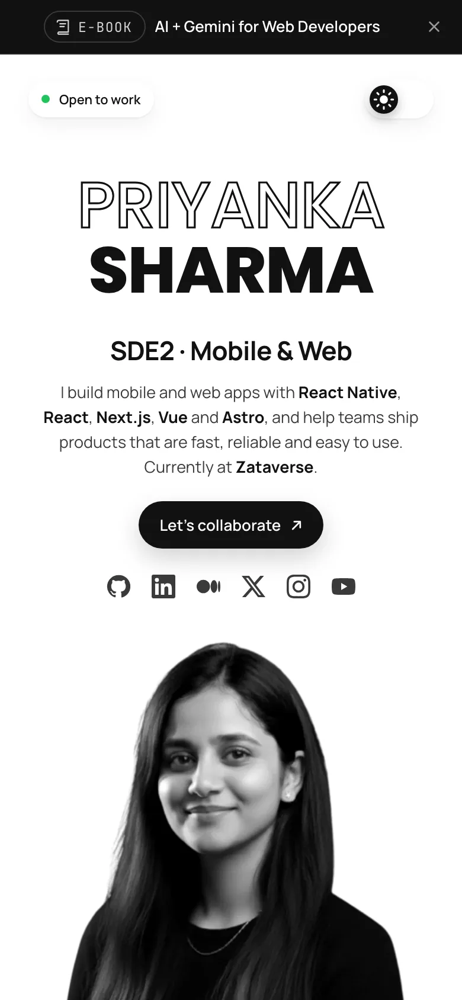
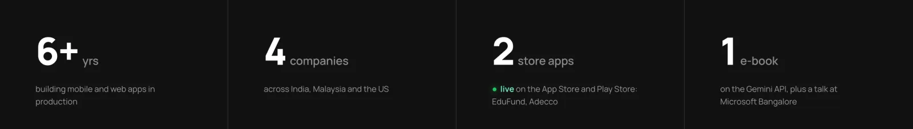
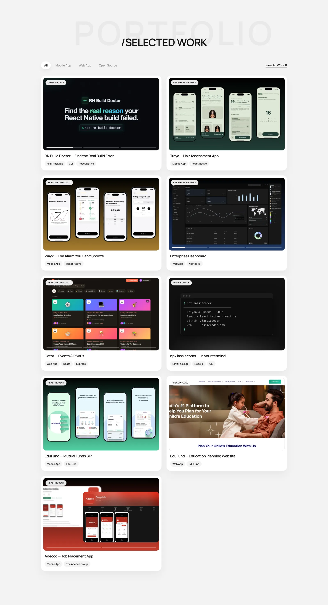
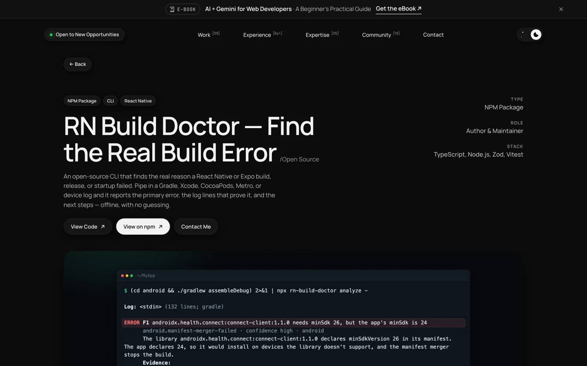
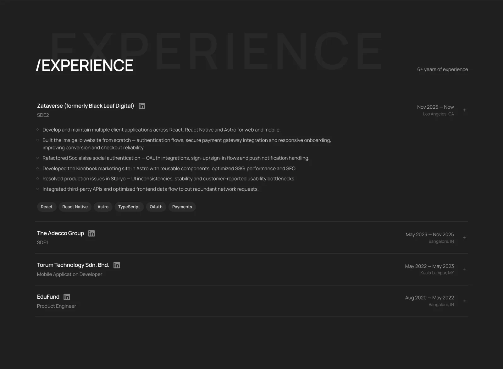
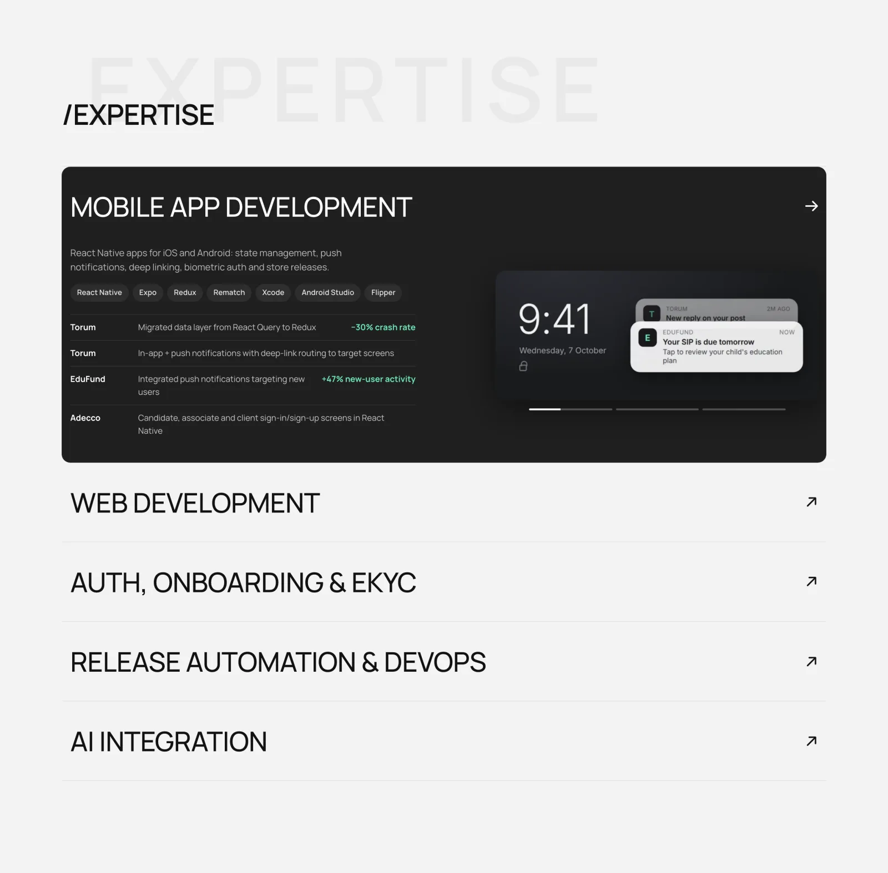
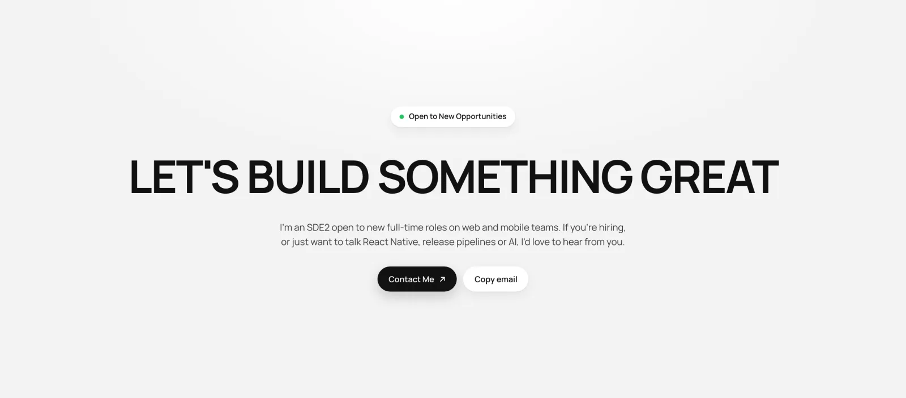

# lassiecoder · Portfolio

Personal portfolio of **Priyanka Sharma** ([@lassiecoder](https://github.com/lassiecoder)), SDE2 building mobile and web apps with React Native, React, Next.js, Vue and Astro.

**Live:** [lassiecoder.com](https://lassiecoder.com)

A hand-built static site: plain HTML, CSS and JavaScript with no framework and no build step for the page itself. It has light and dark themes, project pages, scroll animations, and a custom inspector-style cursor.

---

## Sections

### Hero

The name, a short intro with the main stack, a "Let's collaborate" button and social links. A dismissible bar above the nav links to the e-book. The theme toggle switches between light and dark with a circular reveal.

| Light | Dark |
| --- | --- |
|  |  |

On phones the hero stacks, and the photo grows to fill the space under the intro.



### At a glance

Four stats that rise in one after another as they scroll into view, with the numbers counting up.



### Selected work

Nine projects with live previews (slideshows for projects with several screens), filterable by Mobile App, Web App and Open Source.



Each card opens a project page (hash route `#/work/<slug>`) with screenshots, the stack, highlights and links, plus more work to browse next.



### Experience

6+ years across four companies. Rows expand to show what I did there, and hovering a row on desktop shows a floating metric.



### Expertise

An accordion of five areas: mobile, web, auth and eKYC, release automation and AI integration. Each area lists where I've done it, with screenshots.



### Beyond code

The *AI + Gemini for Web Developers* e-book, a talk at Microsoft Bangalore, and the AWS re:Invent 2025 All Builders Welcome Grant.


### Community

19 events, meetups and milestones, newest first, each linking to its LinkedIn or X post. Photos are black and white until a card is hovered. The grid opens with two rows behind "Show all posts", and becomes a swipeable row on phones.


### Contact



---

## Highlights

- **No framework, no bundler.** `index.html`, `styles.css` and `main.js` are served as they are.
- **Light and dark themes.** The theme follows the OS until the visitor picks one, and is applied before first paint so there's no flash.
- **Scroll reveals.** Each section has its own entrance (masked headings, staggered cards and rows, counting stats). They play once the section is well on screen, and are skipped for visitors who prefer reduced motion.
- **Inspector cursor.** On mouse and trackpad, a crosshair with DevTools-style brackets frames the hovered element and shows its size.
- **Responsive images.** WebP throughout, with `srcset` variants so each device downloads the size it shows.
- **SEO.** Open Graph and Twitter cards, JSON-LD structured data (Person, WebSite, ProfilePage, Book), a sitemap and `robots.txt`.
- **Analytics.** Firebase Analytics (GA4) and PostHog load after the page is idle, and only when their keys are configured.

## Project structure

```
index.html            Page markup: hero, stats, section shells, e-book bar, contact, footer
styles.css            All styles: tokens, light/dark themes, sections, responsive rules
main.js               Content data and rendering: PROJECTS, EXPERTISE, EXPERIENCE, COMMUNITY; interactions
analytics.js          Firebase + PostHog loader and event tracking
scripts/
  build-config.mjs    Writes firebase-config.js and posthog-config.js from environment variables
assets/               Images (WebP), icons, Open Graph image
docs/screenshots/     Screenshots used in this README
vercel.json           Build command and cache headers
sitemap.xml, robots.txt, site.webmanifest, favicon.svg
```

## Run locally

Any static file server works:

```sh
python3 -m http.server 8080
# then open http://localhost:8080
```

Analytics stay off unless their config files exist. To turn them on locally, add the keys to a `.env` file (see below) and run:

```sh
node scripts/build-config.mjs
```

## Editing content

Most content is data at the top of `main.js`:

| What | Where |
| --- | --- |
| Projects and project pages | `PROJECTS` |
| Expertise accordion | `EXPERTISE` |
| Experience rows | `EXPERIENCE` |
| Community cards | `COMMUNITY` (photos in `assets/community-*.webp`) |

The hero, stats, Beyond code and contact sections, the e-book bar, and the SEO metadata are in `index.html`.

## Analytics configuration

`scripts/build-config.mjs` reads these environment variables (Vercel project settings, or `.env` locally) and writes the git-ignored `firebase-config.js` and `posthog-config.js`. A provider whose values are missing stays off.

| Variable | Used for |
| --- | --- |
| `FIREBASE_API_KEY`, `FIREBASE_AUTH_DOMAIN`, `FIREBASE_PROJECT_ID`, `FIREBASE_STORAGE_BUCKET`, `FIREBASE_MESSAGING_SENDER_ID`, `FIREBASE_APP_ID`, `FIREBASE_MEASUREMENT_ID` | Firebase Analytics (the `FIREBASE_` prefix is optional) |
| `POSTHOG_KEY`, `POSTHOG_HOST` (optional, defaults to US cloud) | PostHog |

## Deployment

Deployed on [Vercel](https://vercel.com). `vercel.json` runs `node scripts/build-config.mjs` as the build command, serves the repo root as the site, and sets cache headers for assets, CSS and JS.

## Contact

- Email: [lassiecoder@gmail.com](mailto:lassiecoder@gmail.com)
- [LinkedIn](https://www.linkedin.com/in/priyanka-s-b79401142/) · [GitHub](https://github.com/lassiecoder) · [Medium](https://medium.com/@lassiecoder) · [X](https://x.com/lassiecoder) · [YouTube](https://www.youtube.com/@lassiecoder)
